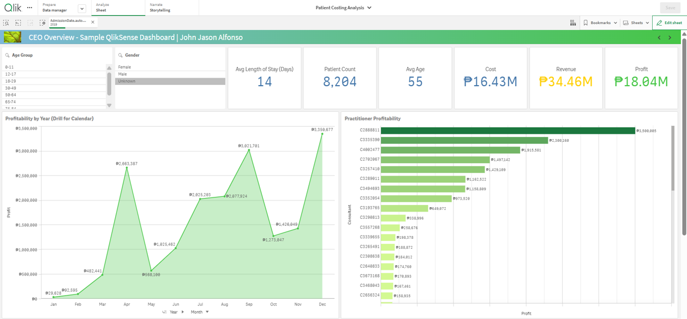
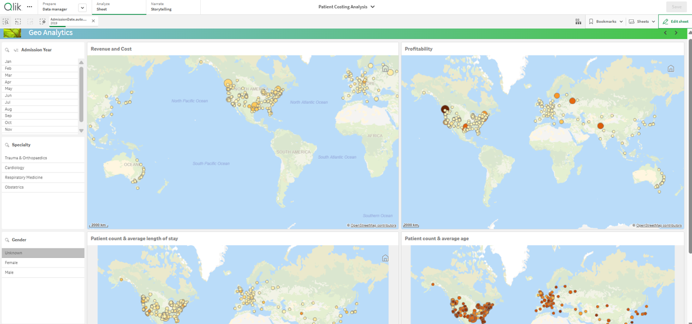
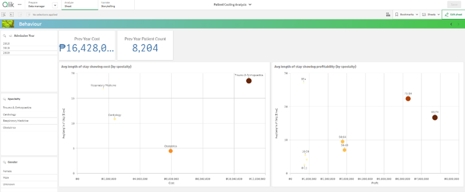
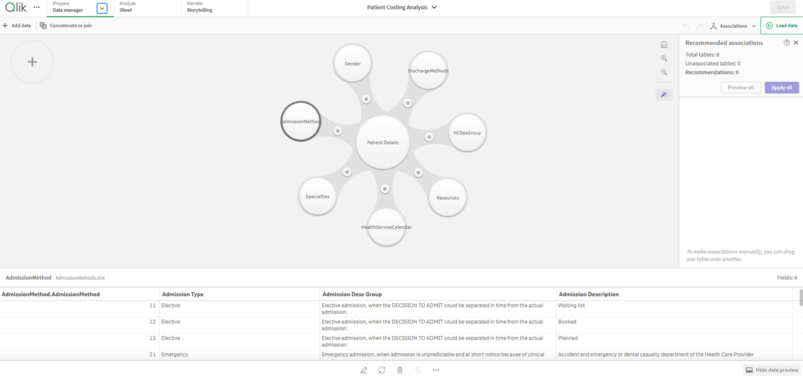

# Business Intelligence Tools

This section showcases business intelligence projects developed using data visualization, dashboard development, data modeling, and reporting platforms.

The projects demonstrate how data can be transformed into meaningful insights through interactive dashboards, KPI development, and visual reporting to support business and operational decisions.

## Projects

### 1. Qlik Sense – Patient Costing Analysis

**Project Overview**

An interactive Qlik Sense dashboard exploring patient activity, healthcare costs, revenue, profitability, and geographic patterns using sample data.

This project demonstrates hands-on experience in Qlik Sense development, data modeling, KPI design, and interactive data visualization.

**Dashboard Pages**

**CEO Overview**

Executive-level KPIs for patient count, average length of stay, average age, cost, revenue, and profit. Includes profitability trends by year and practitioner profitability rankings.

**Geo Analytics**

Interactive maps showing revenue and cost, profitability, patient count, average length of stay, and average age across patient locations.

**Behaviour**

Explores patient cost and profitability patterns by specialty and age group, including average length of stay and previous-year indicators.

**Key Insights**

The dashboard supports analysis of:

- **Executive performance:** Review key performance indicators and practitioner profitability.
- **Geographic patterns:** Explore how patient and cost-related metrics vary across locations.
- **Patient behavior:** Examine length of stay and related patient patterns.
- **Data structure:** Understand how the underlying tables are connected through the Qlik Sense data model.

**Data Model**

The application uses associated tables for patient details, gender, admission and discharge methods, specialties, resources, the health service calendar, and HCResGroup.

**Tools and Techniques**

- Qlik Sense
- Data modeling and table associations
- KPI development and dashboard design
- Interactive filtering and geographic visualization

**Project Files**

- [Patient Costing Analysis.qvf](Qlik-Sense-Patient-Costing-Analysis/Patient%20Costing%20Analysis.qvf) – Qlik Sense application
- `screenshots/` – Dashboard screenshots

---

### 2. Power BI – UK Housing Market Analysis

**Project Overview**

An interactive Power BI dashboard analyzing UK housing market performance using sample data from a Udemy course.

The dashboard explores housing prices, sales activity, and regional market performance through interactive filters, KPI cards, and visual comparisons.

**Dashboard Components**

**Key Performance Indicators**

Provides a high-level overview of housing market performance through three key metrics:

- Average Sale Price
- Total Sales Volume
- Average Annual Price Change

**Regional Housing Market Performance**

Compares average property prices and total sales volume across regions, helping users explore differences in regional housing market activity.

**Average House Price by Property Type**

Compares average house prices across detached, semi-detached, terraced, and flat properties.

**Price and Sales Volume Relationship**

Uses a scatter plot to examine the relationship between average house prices and total sales volume across regions.

**Housing Pricing Details**

Provides a detailed table of housing market information, including region, area, year, month, sales volume, average property price, average sale price, and property-type price measures.

**Interactive Filters**

Allows users to explore the dashboard by:

- Area
- Region
- Property Type

These filters make it easier to investigate housing market patterns across different geographic areas and property categories.

**Tools and Techniques**

- Microsoft Power BI
- Interactive dashboard development
- KPI cards and performance monitoring
- Data visualization and comparative analysis
- Slicers and interactive filtering
- Regional and property-level analysis

**Project Files**

- Power BI dashboard (`.pbix`)
- Dashboard screenshots

**Data Source and Disclaimer**

This is a learning project based on sample data provided through a Udemy course. The dashboard is intended to demonstrate Power BI development and data visualization techniques. It does not represent official or independently verified UK housing market statistics.

---

## Additional BI Projects

Additional projects may be included as the portfolio expands, covering other business intelligence and visualization platforms.

Potential areas include:

- Tableau – Data visualization and analytical dashboards.
- Amazon QuickSight – Business performance monitoring and automated reporting.
