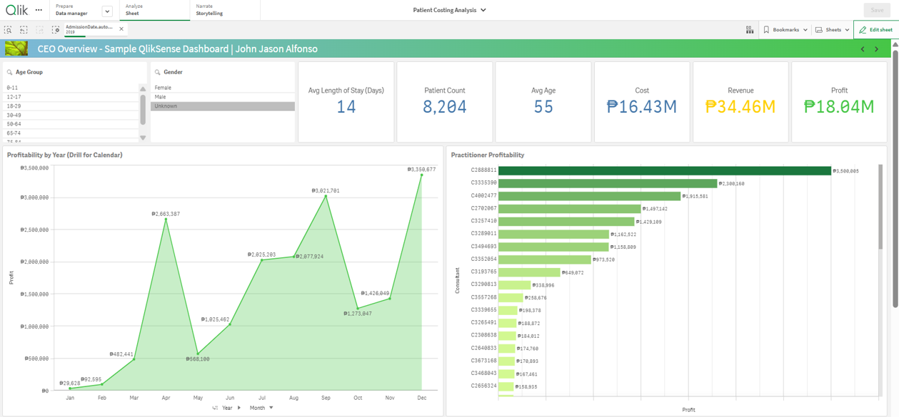
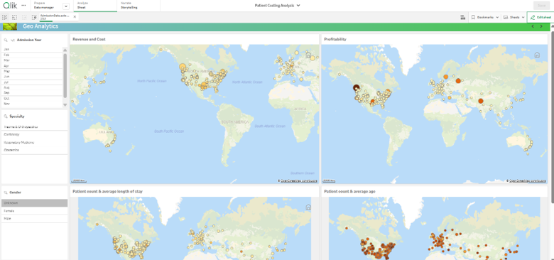
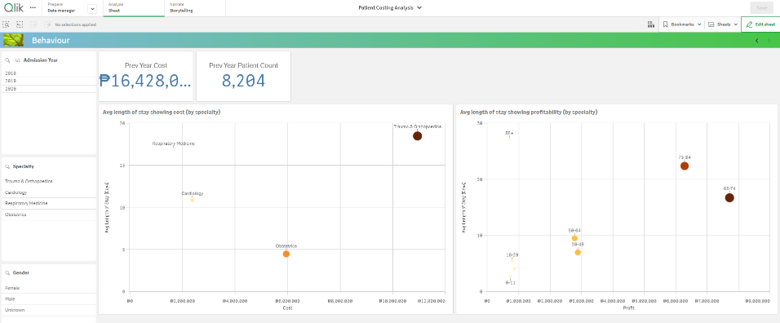
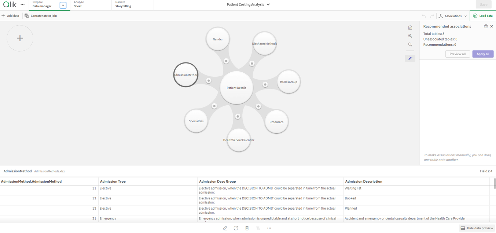

# Patient Costing Analysis — Qlik Sense

## Project Overview

An interactive Qlik Sense dashboard exploring patient activity, healthcare costs, revenue, profitability, and geographic patterns using sample data.

This project demonstrates hands-on experience in Qlik Sense development, data modeling, KPI design, and interactive data visualization.

## Dashboard Pages

### CEO Overview

Executive-level KPIs for patient count, average length of stay, average age, cost, revenue, and profit. Includes profitability trends by year and practitioner profitability rankings.

### Geo Analytics

Interactive maps showing revenue and cost, profitability, patient count, average length of stay, and average age across patient locations.

### Behaviour

Explores patient cost and profitability patterns by specialty and age group, including average length of stay and previous-year indicators.

## Key Insights

The dashboard supports analysis of:

- **Executive performance:** Review key performance indicators and practitioner profitability.
- **Geographic patterns:** Explore how patient and cost-related metrics vary across locations.
- **Patient behavior:** Examine length of stay and related patient patterns.
- **Data structure:** Understand how the underlying tables are connected through the Qlik Sense data model.

The dashboard helps stakeholders explore patterns and support data-informed operational and financial decisions.

## Data Model

The application uses associated tables for patient details, gender, admission and discharge methods, specialties, resources, the health service calendar, and HCResGroup.

## Tools

- Qlik Sense
- Data modeling and table associations
- KPI development and dashboard design
- Interactive filtering and geographic visualization

## Project Files

- [Patient Costing Analysis.qvf](Patient%20Costing%20Analysis.qvf) — Qlik Sense application
- `screenshots/` — Dashboard screenshots

## Data Disclaimer

This portfolio project uses sample data for demonstration purposes.
